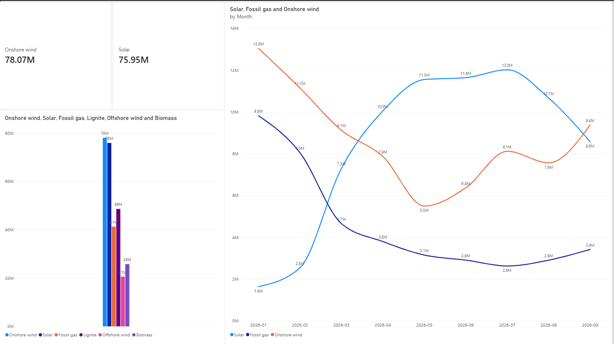

# German Electricity Generation Analysis (Python, SQL & Power BI)

End-to-end data analytics project examining hourly electricity generation across fuel sources in Germany (6,551 hourly records, Jan–Sep 2026).

## Business Questions Answered
1. Which energy sources contribute the highest cumulative megawatt-hour (MWh) output?
2. How do seasonal weather shifts impact the balance between solar, onshore wind, and fossil gas generation?

## Technical Workflow
- **Data Cleaning (Python / Pandas):** Standardized raw column headers, parsed string timestamps into `datetime64`, stripped formatting artifacts, cast numeric generation columns (`float64`), and validated zero missing values before exporting to UTF-8 CSV.
- **Data Querying (SQL / SQLite):** Loaded cleaned records into a local `sqlite3` database to aggregate total and monthly output across fuel types (`SELECT`, `WHERE`, `GROUP BY`).
- **Visualization (Power BI Desktop):** Built an executive 1-page dashboard featuring total generation KPI cards, a fuel-mix comparison bar chart, and chronological monthly trend curves.

## Key Insights
- **Renewables Lead Output:** Onshore Wind (**78.07M MWh**) and Solar (**75.95M MWh**) generated the highest cumulative output, outperforming Lignite (**49M MWh**) and Fossil Gas (**41M MWh**).
- **Seasonal Crossover:** Onshore Wind (**13.0M MWh**) and Fossil Gas (**9.8M MWh**) peak during winter (January) to meet demand, whereas Solar ramps up to peak in July (**12.0M MWh**), reducing reliance on Fossil Gas (**2.6M MWh**).
